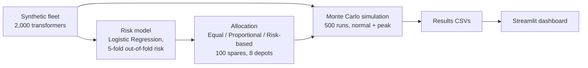

# SpareTransformer

**Risk-Based Spare Transformer Allocation Using Failure-Risk Modeling and Monte Carlo Simulation**

SpareTransformer is a simulation-based decision-support **prototype**. It investigates whether distributing a limited stock of spare electrical distribution transformers across depots according to estimated failure risk improves restoration outcomes compared with simpler allocation rules.

> **Please read first:** All transformer data and failure labels in this project are **synthetic**. Depot locations are **assumed** at eight district headquarters towns in Rajasthan and are not actual DISCOM store locations. Results show how the methods behave under the stated assumptions. They are **not** evidence of real-world performance, and this is not a production or field-validated system.

---

## 1. Problem

A distribution transformer is the last step in the power network. When one fails, every consumer it serves loses supply until a replacement is found, transported and installed. Spares are a limited stock held in depots, so deciding **where to hold them** is a supply-chain problem.

Public reports put distribution transformer failure rates in several Indian state utilities at roughly 10-17% per year, against 1-2% for well-run utilities. In Rajasthan, restoration deadlines for transformer failures are set by the RERC Standards of Performance regulations: 8 hours in urban areas and 24 hours in rural areas (this project uses those two numbers as its deadlines; please verify the clause against the regulation text before citing it).

Questions this project explores:

1. How should a limited number of spare transformers be split across regional depots?
2. Does estimated failure risk add useful information beyond an equal split or a split proportional to transformer counts?
3. Under a demand surge, how do the strategies compare on deadline restoration and stock-outs?

---

## 2. Workflow



Important design choice: the **allocation** step uses the model's *predicted* risk, while the **simulation** draws failures from the hidden *true* failure probability that generated the data. The plan is therefore never graded using the same estimate that produced it.

---

## 3. Synthetic data (`src/data.py`)

- 2,000 transformers placed around eight assumed depot towns in Rajasthan: Jaipur, Alwar, Tonk, Dausa, Bharatpur, Jhalawar, Kota, Sawai Madhopur.
- Depots have unequal weights, so some have many more transformers than others.
- Urban transformers are generated within about 5 km of their town; rural ones 10-40 km away.
- Features: `age_years`, `load_pct`, `oil_temp_c` (temperature rises with load plus noise).
- Assumed regional differences in fleet condition are applied to age and temperature before clipping to the configured bounds. **These are modeling assumptions, not measured regional statistics.** Without them, regions would be statistically identical and risk-based allocation would have nothing to exploit.
- `true_failure_prob` comes from a logistic function of age, load and temperature. The intercept is tuned by bisection so the mean is 0.11, in line with published failure-rate ranges.
- `failed` (0/1) is sampled from `true_failure_prob`.
- `nearest_depot` is computed from coordinates using haversine distance (not from the depot used when generating the location).
- Road distance is estimated as haversine distance x 1.3. Real road-network distances are future work.

Latest data-generation run: mean true failure probability 0.1100, observed failure rate 0.1010, 703 urban and 1,297 rural transformers.

---

## 4. Risk model (`src/model.py`)

- Model: scikit-learn Logistic Regression with standardized features (`StandardScaler` in a pipeline).
- Features: `age_years`, `load_pct`, `oil_temp_c`. The hidden `true_failure_prob` is **not** used as a feature.
- Validation: 5-fold stratified cross-validation with `cross_val_predict(method="predict_proba")`, so every transformer's `predicted_risk` comes from a model that did not train on that row's label.
- Latest recorded cross-validated ROC-AUC: **0.7089**; mean predicted risk: 0.1012.

ROC-AUC measures how well the model ranks failing transformers above non-failing ones (0.5 is random ranking, 1.0 is perfect). Because the labels are synthetic and generated from the same features, this score shows that the pipeline works. It says nothing about calibration or accuracy on real utility assets.

---

## 5. Allocation strategies (`src/allocate.py`)

Each strategy distributes exactly 100 spares across the 8 depots as whole numbers.

| Strategy | Idea |
|---|---|
| **Equal Split** | About the same number of spares per depot. |
| **Proportional Count** | Spares proportional to the number of transformers whose nearest depot it is. |
| **Risk-Based** | Spares proportional to each depot's total predicted failure risk (sum of `predicted_risk` of its transformers), with largest-remainder rounding. |

Risk-based allocation is a simple heuristic. It is **not** claimed to be optimal.

Latest allocation for 100 spares:

| Depot | Equal Split | Proportional Count | Risk-Based |
|---|---:|---:|---:|
| Jaipur | 13 | 26 | 24 |
| Alwar | 13 | 16 | 20 |
| Tonk | 13 | 10 | 8 |
| Dausa | 13 | 9 | 6 |
| Bharatpur | 12 | 11 | 14 |
| Jhalawar | 12 | 8 | 6 |
| Kota | 12 | 13 | 17 |
| Sawai Madhopur | 12 | 7 | 5 |
| **Total** | **100** | **100** | **100** |

These are outputs of the current model and assumptions, not recommendations for any real utility.

---

## 6. Simulation method (`src/simulate.py`)

For each scenario and each of 500 runs (seeded, `RANDOM_SEED = 42`):

1. **Failures** are drawn from `true_failure_prob`, rescaled so the expected number of failures is 70 per run in the **normal** scenario (70% of the spare stock) and 140 in the **peak** scenario (a 2x multiplier).
2. The failed transformers, their processing order and their handling times are drawn **once per run and reused for all three strategies** (paired comparison).
3. For each failure, in random order, a spare is taken from the **nearest depot with stock within 80 km road distance** (borrowing from neighboring depots is allowed within that limit). Stock is not replenished during a run.
4. **Restoration time** = road distance / speed (urban 40 km/h, rural 30 km/h) + handling time (uniform 3-6 hours).
5. If no depot within 80 km has a spare, it is counted as a **stock-out**, and restoration time is set to a flat **12-hour central-store delay**. The central store has no location and unlimited stock in this model.
6. A failure is "on time" if restoration is within **8 hours (urban)** or **24 hours (rural)**.

Metrics per strategy and scenario: % of failures restored within deadline, mean restoration time, 95th-percentile restoration time, and stock-outs. Differences between strategies are reported as paired differences with 95% Student-t confidence intervals across runs.

---

## 7. Results

Values below come from the saved outputs of the latest run on the author's machine (500 runs per strategy and scenario). Standard deviations describe run-to-run variability, not confidence intervals.

### Normal demand (70 expected failures)

| Strategy | On-time restoration | Std. dev. (pp) | Mean stock-outs | Mean time (h) | p95 time (h) |
|---|---:|---:|---:|---:|---:|
| Equal Split | 97.808% | 2.238 | 5.082 | 5.527 | 9.879 |
| Proportional Count | 98.691% | 1.718 | 2.778 | 5.228 | 8.204 |
| Risk-Based | 99.514% | 0.981 | 1.000 | 5.057 | 6.786 |

### Peak demand (140 expected failures)

| Strategy | On-time restoration | Std. dev. (pp) | Mean stock-outs | Mean time (h) | p95 time (h) |
|---|---:|---:|---:|---:|---:|
| Equal Split | 87.554% | 2.723 | 51.892 | 7.654 | 12.000 |
| Proportional Count | 89.182% | 2.690 | 43.638 | 7.168 | 12.000 |
| Risk-Based | 89.977% | 2.792 | 41.216 | 7.030 | 12.000 |

In the peak scenario the 95th-percentile time sits at 12 hours for every strategy because more than 5% of failures hit the assumed flat 12-hour central-store delay. This is a property of that assumption, not a finding about the strategies.

### Paired differences in on-time restoration (percentage points, 95% CI)

| Scenario | Comparison | Mean difference | 95% CI |
|---|---|---:|---|
| Normal | Risk-Based - Proportional Count | +0.823 | [0.690, 0.956] |
| Normal | Risk-Based - Equal Split | +1.706 | [1.522, 1.891] |
| Peak | Risk-Based - Proportional Count | +0.795 | [0.660, 0.930] |
| Peak | Risk-Based - Equal Split | +2.423 | [2.248, 2.598] |

### How to read these results

- Under these assumptions, risk-based allocation scored best on every metric in both scenarios. The advantage is **modest**.
- Under peak demand, risk-based allocation had about 20.6% fewer simulated stock-outs than equal split (41.216 vs 51.892). This is a simulation-derived comparison under stated assumptions, not a real-world effect.
- The confidence intervals reflect simulation noise only. With 500 runs, even small differences get narrow intervals. They do not capture real-world uncertainty.
- Even the best strategy has about 41 stock-outs in the peak scenario, because 140 failures exceed 100 spares. Placement helps, but stock size matters more.
- The on-time percentages depend heavily on the assumed 12-hour central-store delay: that value is below the 24-hour rural deadline, so rural stock-outs still count as on time. Compare stock-outs alongside on-time percentages.
- The advantage exists partly because the data includes assumed regional differences in fleet condition (see Section 3).

> In simulation, risk-based pre-positioning improved deadline restoration and reduced stock-outs relative to equal allocation under the modeled scenarios and assumptions. These findings require validation against real utility data before operational conclusions can be drawn.

---

## 8. Dashboard (`app.py`)

A Streamlit dashboard presents the **saved** simulation results. It does not retrain the model or rerun the simulation. It provides:

- a normal / peak scenario selector
- summary metrics for the three strategies
- a results table
- a paired-difference table with confidence intervals
- a list of simulation assumptions and a warning that results are simulation-based

It reads `results/strategy_summary.csv` and `results/paired_differences.csv`.

<!-- Screenshot can be added later:  -->

---

## 9. Repository structure

```text
SpareTransformer/
├── app.py
├── run_pipeline.py          (if present; see "Running" below)
├── requirements.txt
├── src/
│   ├── __init__.py
│   ├── config.py
│   ├── data.py
│   ├── model.py
│   ├── allocate.py
│   └── simulate.py
├── data/
│   ├── transformers.csv
│   └── simulation_results.csv
├── results/
│   ├── strategy_summary.csv
│   └── paired_differences.csv
└── README.md
```

---

## 10. Installation

Requires Python 3.12. Windows PowerShell:

```powershell
git clone https://github.com/dhruvsethh-30/SpareTransformer.git
cd SpareTransformer

py -3.12 -m venv .venv
.\.venv\Scripts\Activate.ps1

python -m pip install --upgrade pip
pip install -r requirements.txt
```

The code imports `numpy`, `pandas`, `scikit-learn`, `scipy` and `streamlit`. If `requirements.txt` is missing a package, install it manually, for example `pip install numpy pandas scikit-learn scipy streamlit`.

---

## 11. Running

Run the stages in this order from the repository root:

```powershell
python -m src.data        # generate the synthetic fleet -> data/transformers.csv
python -m src.model       # add out-of-fold predicted_risk, print ROC-AUC
python -m src.allocate    # print the three allocations
python -m src.simulate    # run the Monte Carlo simulation -> data/simulation_results.csv
python -m streamlit run app.py   # launch the dashboard
```

The dashboard needs the saved CSVs in `results/`. The committed copies correspond to the results in Section 7. Running `python -m src.simulate` regenerates the run-level file `data/simulation_results.csv` and prints the summary and paired-difference tables.

---

## 12. Configuration (`src/config.py`)

| Setting | Value |
|---|---|
| Random seed | 42 |
| Transformers / depots / spares | 2,000 / 8 / 100 |
| Road distance factor | 1.3 |
| Speeds (rural / urban) | 30 / 40 km/h |
| Handling time | 3-6 hours |
| Central-store delay | 12 hours |
| Deadlines (urban / rural) | 8 / 24 hours |
| Mean failure probability | 0.11 |
| Monte Carlo runs | 500 |
| Peak multiplier | 2.0 |
| Max borrowing distance | 80 km |

---

## 13. Limitations

- **The data is synthetic.** It is not real utility asset or failure data.
- **Depot locations are assumed** at district HQ towns. Actual DISCOM store locations are not public. In Kota and Bharatpur cities, supply is run by franchisees, so those depots stand for district-level stock.
- **Regional differences in fleet condition are assumptions.** The result that risk-based allocation helps depends on them.
- **Failure probabilities are model outputs,** not verified real-world probabilities. The AUC shows the pipeline works, not real accuracy.
- The **12-hour central-store delay** and **80 km borrowing limit** are assumptions, and results depend on them. No sensitivity analysis has been completed yet.
- **No restocking** during a simulated period, and the central store is unlimited with no location. The peak scenario is a stress test, not a time series.
- Road distance is haversine x 1.3, not a road network.
- Only two scenarios, 500 runs each, and the metrics listed above were evaluated.
- The dashboard shows saved outputs. It is not a real-time monitoring or forecasting service.
- Real utility data, validation and operational constraints would be needed before any deployment.

---

## 14. Future work (not implemented)

- Validation against anonymized utility asset and failure data
- Sensitivity analysis for the central-store delay and borrowing limit
- Real road-network distances and transformer-compatibility constraints
- Explicit inventory and replenishment costs and restocking over time
- Broader uncertainty analysis and more demand scenarios
- Comparison with optimization-based inventory policies
- Better model calibration and out-of-sample evaluation
- Exportable reports and richer visualization

---

## 15. Data sources and context

Published figures on distribution transformer failure rates in India (Power Line, "Premature breakdown", 2022; T&D India seminar report; CEA Guidelines for O&M of Distribution Transformers, 2023) and the RERC Standards of Performance regulations motivated the problem framing and calibration. Please check the original sources before quoting them.

---

## 16. AI-assistance note

Claude and ChatGPT were used for brainstorming, code guidance, and review. The simulation outputs reported above were generated and checked by running the code locally.

## License

MIT License (add a `LICENSE` file to the repository).